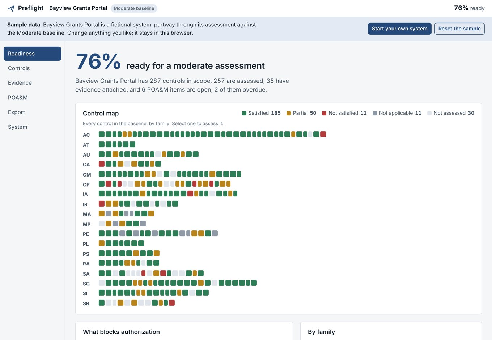
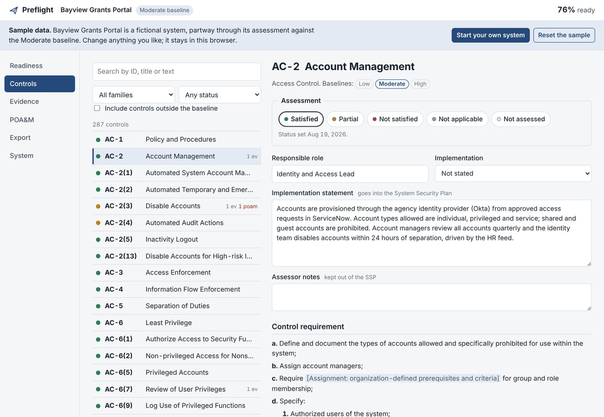

# Preflight

ATO readiness tracker for federal contractors. Assess every NIST SP 800-53 Rev. 5 control in your baseline, attach evidence with SHA-256 fingerprints, track POA&M items, see what blocks authorization, and export a draft System Security Plan in Markdown or OSCAL. It runs entirely in the browser, and nothing is uploaded.

**[Try the demo](https://jasonzawacki-arch.github.io/preflight/)**: it opens on a fictional system partway through a Moderate assessment. No sign-in.



## What it does

- **The real control catalog.** All 1,014 controls and enhancements from NIST's OSCAL release of SP 800-53 Rev. 5.2.0, with the Low (149), Moderate (287), High (370) and privacy (96) baselines. Statements show their parameters the way NIST prints them, `[Assignment: organization-defined frequency]`.
- **Assess each control.** Set a status, write the implementation statement that goes into the SSP, and name the responsible role and whether the control is inherited. Each control also shows NIST's SP 800-53A "Examine" list, the artifacts an assessor will ask for, so you can use it as an evidence checklist.
- **Evidence with fingerprints.** Attach files to one or more controls. The browser computes each file's SHA-256 and keeps the file. "Check a file" tells you whether a file in hand matches evidence on record, which answers an assessor's question of whether anything has changed. Evidence older than a year is flagged.
- **POA&M tracker.** Weaknesses with severity, status, source, point of contact, dated milestones and residual risk. Overdue items are flagged.
- **What blocks authorization.** The readiness page lists what a reviewer would catch:
  - open high-risk findings
  - gaps with no POA&M
  - overdue milestones
  - controls not assessed yet
  - satisfied controls with no evidence
  - missing implementation statements
  - stale evidence
  - not applicable with no justification
  - risk acceptances with no residual risk statement
- **Exports.**
  - SSP as Markdown, to edit.
  - SSP as OSCAL JSON, with evidence and its hashes in back matter.
  - POA&M as OSCAL JSON and as CSV.
  - A full backup that restores here or on another computer, and checks every file's fingerprint as it does.

  Both OSCAL exports validate against NIST's OSCAL 1.2.1 schemas in the test suite.



## Your data

Preflight is a static page. The assessment and the evidence files live in the browser's IndexedDB on your device, and the app makes no requests except for its web font. Download a backup from Export to keep a copy or move to another computer. Once loaded, the hosted version also works offline and can be installed as an app.

## Build and test

```sh
npm install
npm run build          # type-check, then write dist/preflight.html and dist/site/
pip install playwright jsonschema && python -m playwright install chromium
npm test               # browser tests and OSCAL schema validation
```

The build is a small dependency-free bundler (`build.mjs`) that inlines the TypeScript, the CSS and the catalog into one HTML file. CI runs the tests on every push, and every push to `main` publishes `dist/site` to GitHub Pages.

### Updating the catalog

`src/data/catalog.json` is generated from NIST's OSCAL content:

```sh
git clone --depth 1 https://github.com/usnistgov/oscal-content
python3 tools/import_oscal.py oscal-content/nist.gov/SP800-53/rev5/json
```

## Layout

| Path | What it is |
|---|---|
| `src/model.ts` | Data model: system, assessments, evidence, POA&M, readiness |
| `src/logic.ts` | Scope, readiness score and blockers (pure functions) |
| `src/ui.ts` | The screens |
| `src/exports.ts` | SSP Markdown, OSCAL SSP and POA&M, CSV, backup and restore |
| `src/store.ts` | IndexedDB storage for the assessment and evidence files |
| `src/demo.ts` | The fictional sample system |
| `tools/import_oscal.py` | Builds the catalog from NIST OSCAL |
| `tests/` | Playwright tests and the OSCAL schemas they validate against |

## Roadmap

1. ~~Control browser, evidence, readiness dashboard~~
2. ~~POA&M tracker~~
3. ~~SSP export (Markdown and OSCAL)~~
4. Evidence collectors: AWS Config and Prowler findings mapped to controls
5. Data packs: FedRAMP, DoD and DHS overlays, control interpretations
6. Import an existing OSCAL SSP

## License

MIT, see [LICENSE](LICENSE). The NIST catalog and schemas are public domain.
